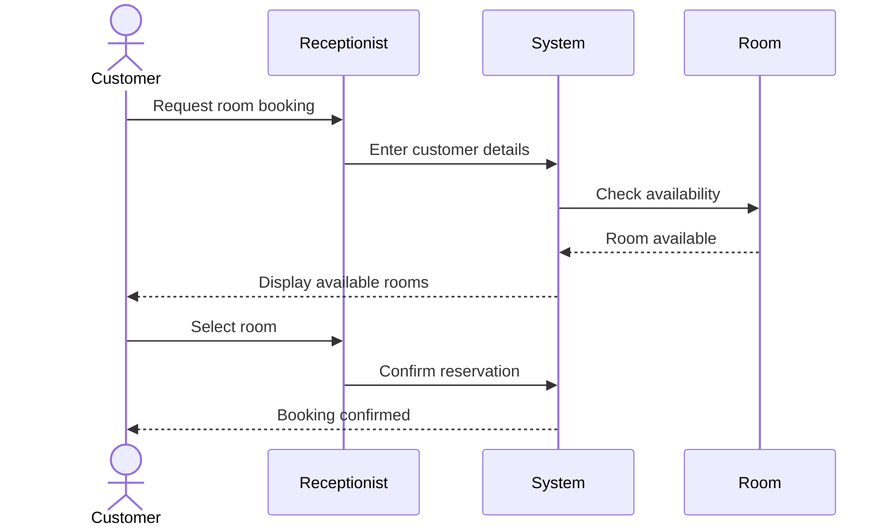
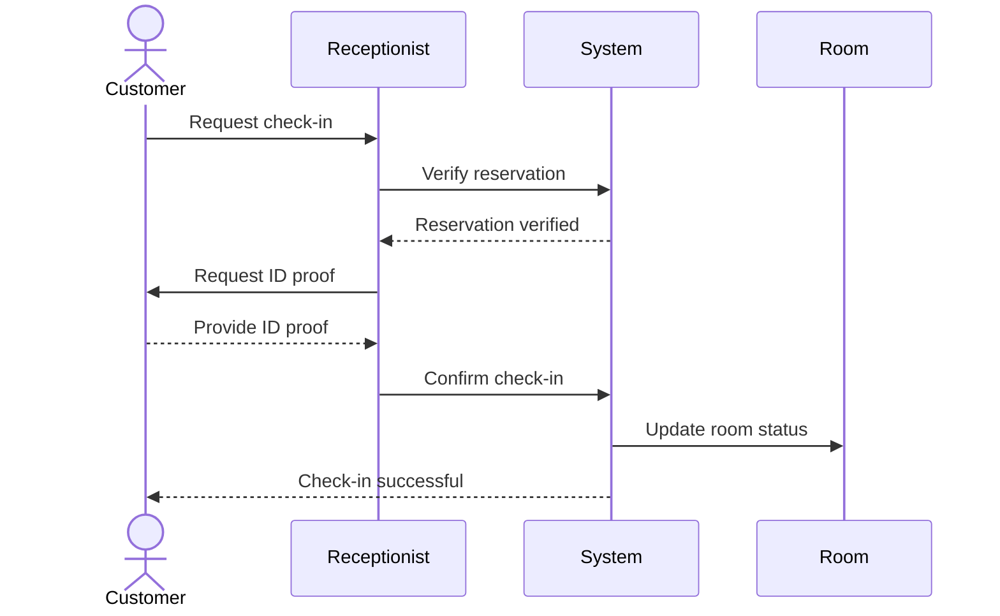
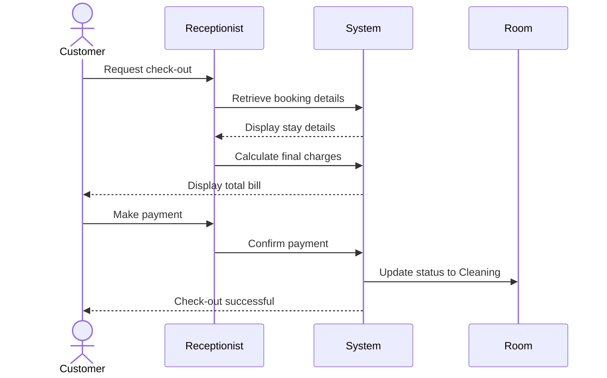
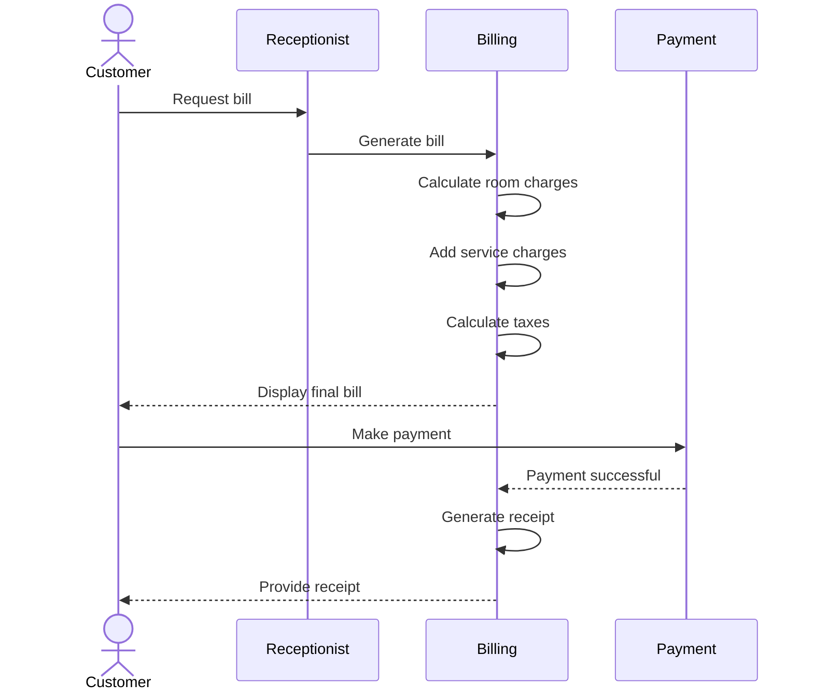

# hotel--management--system

# HOTEL MANAGEMENT SYSTEM

## Objective
To develop a Hotel Management System that manages room reservations, customer check-in, check-out and billing.

## 1. Room Reservation UML Diagram

## 2. Customer Check-in UML Diagram

## 3. Customer Check-out UML Diagram

## 4. Billing UML Diagram

## Conclusion
The Hotel Management System simplifies room reservations, check-in, check-out and billing. UML diagrams represent the interactions between customers, receptionists and the system.
